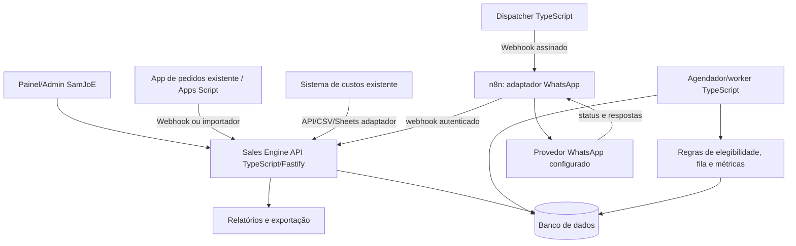

# SPEC — SamJoE Sales Engine

**Versão:** 1.1.0  
**Data de referência:** 10/10/2026  
**Status:** Especificação para implementação incremental por agente local  
**Produto inicial:** Operação comercial da SamJoE Confeitaria  
**Evolução possível:** Plataforma SaaS de relacionamento, recorrência e campanhas para pequenos negócios

> **INSTRUÇÃO AO AGENTE LOCAL:** Antes de modificar qualquer projeto, faça inventário do código existente, variáveis e integrações, leia esta especificação e o plano de execução, apresente uma análise de lacunas e preserve funcionalidades em produção. NÃO recrie o aplicativo de pedidos, o sistema de custos ou os fluxos n8n existentes sem demonstrar necessidade. Desenvolva por etapas verificáveis, com testes e documentação. Não execute disparos reais sem autorização operacional específica.

---

## 1. Contexto e decisão de produto

A SamJoE Confeitaria vende doces artesanais (cones recheados, copos premium como Kinder/Ferrero/Dubai e futura linha fit). Há experiência de venda de cerca de **50 cones por fim de semana em um projeto da igreja**, cuja renda é destinada ao projeto. Essas vendas **não constituem receita atual da empresa** e não validam automaticamente a mesma demanda, preço ou recorrência no mercado externo.

O objetivo é formar **carteira própria de compradores** por contatos pessoais autorizados, encomendas, indicações, campanhas e recompra. A comercialização não deve depender de cultos ou da agenda da igreja. Eventuais clientes oriundos da comunidade entram voluntariamente, sem uso indevido de listas ou pressão religiosa.

Premissas iniciais, ajustáveis via configuração (não fixar em código):

| Indicador | Valor/referência | Observação |
|---|---:|---|
| Preço comercial do cone | R$ 15,00 | Valor definido para a operação comercial |
| Custo direto unitário do cone | R$ 5,00 a R$ 6,00 | Deve ser apurado por lote/sabor |
| Margem unitária preliminar do cone | R$ 9,00 a R$ 10,00 | Antes de frete subsidiado, taxas, perdas, impostos e demais custos |
| Contatos iniciais estimados | ~100 | São **prospects**, não clientes nem autorizados automaticamente para automação |
| Meta inicial de pedidos | 150 doces | Meta de teste comercial, sem previsão garantida |
| Meta financeira prioritária | R$ 2.500/mês | **Resultado disponível adicional**, não faturamento bruto |
| Meta aspiracional dezembro/2026 | R$ 15.000/mês | **Faturamento**, cenário-alvo a validar |
| Campanha de indicação | Brinde após compra de R$ 40+ | Regras precisas abaixo |

Outros produtos podem ter tíquete superior, mas **preços e margens não devem ser inventados**. Precisam vir do cadastro de produtos e sistema de custos. O negócio poderá usar empréstimos pontuais de familiares para capital de giro, mas esses valores são passivos e não receita nem lucro.

### 1.1 Problema

- Vendas dispersas em conversas e contatos, sem registro robusto de abordagem, interesse, encomendas e recompra.
- Necessidade de planejar mensagens individuais e futuras ofertas sem perder histórico ou importunar pessoas.
- Necessidade de acompanhar funil comercial, produção por lote e caixa real.
- Necessidade de conectar canais sem depender da lógica interna dos provedores de mensagens.
- Necessidade de transformar uma operação própria comprovada em possível produto SaaS no futuro.

### 1.2 Proposta de valor

**Motor de vendas e relacionamento** que transforma contatos voluntários em clientes recorrentes, coordena campanhas e indicações, registra resultados e alimenta relatórios, sem obrigar o usuário a administrar manualmente cada interação.

### 1.3 Princípios inegociáveis

1. **Vender antes de sofisticar.** O app e o Sales Engine não bloqueiam vendas manuais por WhatsApp.
2. **O Sales Engine é o sistema de registro e regras comerciais.** A implementação inicial usa Node.js, TypeScript e Fastify; n8n é somente o adaptador operacional de WhatsApp.
3. **Sem duplicidade:** pedidos, envios, eventos e benefícios precisam ser idempotentes.
4. **Opt-in para comunicações promocionais pelo WhatsApp.** Conhecer alguém ou ter seu número salvo NÃO equivale a consentimento para mensagens automatizadas.
5. **Resultados financeiros rigorosos:** faturamento ≠ margem ≠ lucro ≠ caixa disponível.
6. **Produção por demanda e lotes controlados**, com reserva do capital de giro.
7. **Não modificar sistemas existentes sem inventário**, testes e estratégia de migração.
8. **Multiempresa no modelo de dados, monoempresa na interface do MVP.** SaaS só após validar a operação.
9. **Simplicidade operacional:** interface e relatórios devem ser utilizáveis pela pessoa responsável pelas encomendas/produção.

---

## 2. Escopo e fases

### Fase 0 — Inventário e segurança (obrigatória)

- Identificar repositórios locais do app de vendas, controle de custos/relatórios, Apps Script, planilhas, integrações, Cloudflare, n8n, Evolution API ou outro provedor.
- Documentar o que está funcionando, o que é protótipo e o que depende de deploy ou credenciais.
- Verificar tabelas, schemas, formato de pedidos, formatos de eventos, disponibilidade de API e localização do banco atual.
- Não copiar segredos ou dados pessoais para logs, prompts, git ou relatórios.
- Criar `.env.example`, nunca versionar `.env` real.
- Emitir `docs/INVENTARIO.md` e `docs/GAPS.md` antes de implementar alterações.

### Fase 1 — MVP comercial operacional (prioridade máxima)

- Cadastro e importação de prospects/clientes (CSV/Sheets ou manual).
- Normalização e deduplicação de telefones BR (E.164), sem fusão automática arriscada.
- Consentimento para contato comercial no WhatsApp com trilha de origem/data/finalidade, estados e revogação.
- Registro de contatos **manuais** feitos com amigos/conhecidos e conversões em opt-in.
- Produtos e preços comerciais, com custos importados ou registrados.
- Campanhas, segmentação básica, cronograma e aprovação humana.
- Fila persistente de envio, histórico de comunicação, respostas, falhas e opt-out.
- Integração de pedidos existentes ou importação manual com origem registrada.
- Campanha de indicação com validação da compra e brinde.
- Relatórios de contatos, pedidos, faturamento, margem estimada, taxa de recompra, caixa e meta.
- Exportação CSV e backup documentado.

### Fase 2 — Operação estabilizada

- Sincronização automática bidirecional com app de pedidos e sistema de custos, onde tecnicamente viável.
- Agenda comercial: pós-compra, recompra, aniversário de compra, recomendações por preferências explícitas.
- Controle de produção por lotes, disponibilidade, estoque/insumos e previsão de compras (integrar em vez de duplicar o módulo existente).
- Dashboards por campanhas, sabores, ticket médio, segmento e canal.
- Registro de custos efetivos, desperdício, pagamento, entrega, cancelamento e estorno.
- Gestão de benefícios de indicação e antiabuso.

### Fase 3 — SaaS comercial (após prova real)

- Interface multiempresa com autenticação e autorização por tenant.
- Planos, limites, cobrança recorrente, onboarding, administração e suporte.
- Conectores independentes para WhatsApp oficial e demais canais permitidos.
- Isolamento por empresa, auditoria, retenção/exclusão, monitoramento, observabilidade.
- Mensuração de custo operacional por tenant e viabilidade de precificação.
- Não presumir que as mensalidades hipotéticas discutidas sejam preços validados.

### Fora do MVP

- Agente de IA conversando automaticamente com compradores.
- Envio massivo para listas compradas, raspadas ou grupos sem adesão individual.
- Aplicativo mobile nativo, marketplace, programa de afiliados complexo.
- Gestão fiscal/contábil completa ou substituição de ERP.
- Reconstrução do aplicativo de pedidos já existente.
- Usos eleitorais, políticos ou campanhas partidárias: **fora do produto**.

---

## 3. Arquitetura de referência



### 3.1 Stack recomendada (não obrigatória se infraestrutura existente divergir)

- Backend: Node.js LTS, TypeScript em modo estrito, Fastify, validação por schemas Zod ou TypeBox e testes com Vitest.
- Persistência: PostgreSQL desde o primeiro ambiente, migrations versionadas e valores monetários em centavos inteiros ou `numeric`/Decimal. O Sales Engine possui banco próprio e não acessa diretamente tabelas do SamJoE Food.
- Agendamentos: processo TypeScript executado por cron/serviço ou worker separado. Não depender de timer em processo HTTP efêmero. Usar fila transacional no PostgreSQL inicialmente; adicionar Redis somente quando uma necessidade medida justificar.
- n8n: um workflow de envio e outro de retorno/status/entrada; sem regras de CRM nem cópia paralela do banco mestre.
- WhatsApp: um `MessagingProvider` abstrato. Adaptador Evolution API para ambiente já em uso, **sujeito a avaliação de riscos**, e planejamento de migração para WhatsApp Business Platform oficial. Não contornar bloqueios, limites ou políticas.
- Interface: Next.js + TypeScript, alinhado ao SamJoE Food, mantendo aplicação, deploy e identidade de produto independentes. Priorizar usabilidade e não compartilhar estado interno entre os produtos.
- Infra: backend em container próprio na VPS, publicado por Cloudflare Tunnel e proxy interno. Cloudflare Pages pode hospedar frontend estático, mas não substitui o processo Node.js da API.
- Serviços especializados: Python é permitido para IA, previsão, otimização ou análise avançada, sempre atrás de contrato versionado; não é requisito do núcleo do CRM.
- Fuso funcional: `America/Sao_Paulo`; armazenar instantes em UTC e converter na exibição/agendamento.

### 3.2 Limites de responsabilidade

**Sales Engine:** cadastro, consentimento, segmentação, campanha, agendamento, aprovação, limites de frequência, projeções de pedidos, indicação, benefícios, relatórios, deduplicação e auditoria.

**n8n:** recebe solicitação autorizada de envio, chama provedor, reporta aceitação/erro, recebe webhooks do provedor e devolve eventos normalizados. Sem calcular próxima campanha, margem, segmento, opt-in ou recompensa.

**SamJoE Food/app de pedidos existente:** fonte de verdade de catálogo vendável, preço, carrinho, checkout, pedidos, pagamentos e entregas. Integração via API/eventos; o Sales Engine mantém projeções e snapshots para CRM e relatórios, sem editar diretamente o banco do SamJoE Food.

**Sistema de custos existente:** fonte prioritária das fichas técnicas, ingredientes, custos e lotes. Sales Engine recebe snapshots dos custos usados na venda por adaptador, sem incorporar arbitrariamente o banco legado.

### 3.3 Independência entre produtos

SamJoE Food e Sales Engine são produtos vendáveis e implantáveis de forma independente. Cada um terá repositório, banco, configuração, domínio, autenticação e ciclo de release próprios. A indisponibilidade do Sales Engine não pode impedir catálogo, checkout ou acompanhamento de pedidos no SamJoE Food.

Integrações usam HTTPS, contratos versionados, assinatura HMAC, `event_id` e chaves de idempotência. Não haverá leitura direta do banco do outro produto nem importação por caminho relativo entre repositórios. Contratos podem ser publicados como pacote versionado `@samjoe/contracts` ou gerar clientes a partir de OpenAPI, sem acoplar os deploys.

---

## 4. Domínio e entidades de dados

Todas as entidades comerciais persistidas terão `id` UUID, `tenant_id`, `created_at`, `updated_at` onde aplicável. Chaves estrangeiras e índices explícitos.

### 4.1 `tenants`

- `id`, `slug`, `name`, `timezone`, `status`, `settings_json`.
- MVP: único tenant `samjoe-confeitaria`; não construir interface multiempresa ainda.

### 4.2 `users`, `memberships`

- `users`: `id`, `email`, `password_hash` (se login local), `status`, `last_login_at`.
- `memberships`: `user_id`, `tenant_id`, `role` (`owner`, `manager`, `operator`, `viewer`).
- No MVP, contas mínimas da administração; nunca expor API comercial sem autenticação.

### 4.3 `contacts`

- `id`, `tenant_id`, `full_name`, `phone_e164`, `email?`, `origin`, `stage`, `tags_json`, `preferences_json`, `notes?`, `owner_id?`, `last_purchase_at?`, `last_outbound_at?`, `next_eligible_at?`, `do_not_contact`, `merged_into_id?`.
- `origin`: `personal_network`, `app_order`, `referral`, `organic`, `partner`, `import`, etc.
- `stage`: `prospect`, `invited`, `opted_in`, `interested`, `first_buyer`, `repeat_buyer`, `inactive`, `blocked`.
- Regra: `UNIQUE(tenant_id, phone_e164)` para telefone presente; não deduplicar só pelo nome.
- Não registrar atributos sensíveis ou perfis comportamentais excessivos.

### 4.4 `consent_events`

- `id`, `contact_id`, `tenant_id`, `channel`, `purpose` (`marketing`, `order_updates`), `action` (`granted`, `revoked`), `source`, `evidence_ref?`, `policy_version`, `occurred_at`, `recorded_by`.
- Manter histórico imutável de aceite/revogação.
- Projeção do consentimento atual pode ser calculada ou mantida em tabela otimizada, sempre coerente com eventos.
- Opt-out prevalece sobre campanhas agendadas e invalida imediatamente as pendências promocionais.
- Mensagens estritamente transacionais devem ter finalidade e base jurídica analisadas separadamente das promocionais.

### 4.5 `products` e `product_price_history`

- `products`: `id`, `tenant_id`, `sku`, `name`, `category` (`cone`, `premium_cup`, `fit`, `kit`, `other`), `active`, `cost_source`, `current_price_cents`, `current_estimated_unit_cost_cents`, `production_minutes?`, `shelf_life_hours?`.
- `product_price_history`: preço, início de validade, usuário, motivo.
- Categorias não indicam propriedades nutricionais verificadas. Não rotular `fit`, `sem açúcar`, `proteico` etc. sem ficha nutricional/ingredientes compatíveis e observância de normas aplicáveis.
- Valores monetários em centavos inteiros ou Decimal; nunca float para cálculo financeiro.

### 4.6 `campaigns`, `campaign_audiences`, `campaign_messages`

- `campaigns`: `id`, `tenant_id`, `name`, `goal`, `channel`, `template_id?`, `message_text`, `segment_spec_json`, `starts_at`, `ends_at`, `status`, `approved_by?`, `approved_at?`, `max_contacts?`, `max_spend_cents?`.
- Status: `draft` → `ready_for_review` → `approved` → `active` → `completed` / `paused` / `cancelled`.
- `campaign_audiences`: snapshot da seleção no momento de aprovação; revisão da elegibilidade imediatamente antes do envio.
- `campaign_messages`: `id`, `tenant_id`, `campaign_id`, `contact_id`, `scheduled_at`, `state`, `attempts`, `provider`, `provider_message_id?`, `external_key`, `last_error?`, `sent_at?`, `delivered_at?`, `read_at?`, `replied_at?`, `next_retry_at?`.
- `UNIQUE(tenant_id, campaign_id, contact_id, message_variant)` para não multiplicar o mesmo convite/campanha inadvertidamente.

### 4.7 `message_events` e `inbound_messages`

- Eventos append-only: payload minimizado, tipo (`accepted`, `sent`, `delivered`, `read`, `failed`, `replied`), IDs correlacionados, timestamp, origem, chave de idempotência.
- Resposta do cliente não equivale a pedido, compra ou consentimento para qualquer categoria.
- Mensagens recebidas que indiquem `PARAR`, `SAIR`, `CANCELAR`, `NÃO QUERO` (variações) desencadeiam revisão/opt-out imediato, com confirmação quando apropriado.

### 4.8 `orders`, `order_items`, `payments`, `fulfillments`

- `orders`: `id`, `tenant_id`, `external_order_id?`, `contact_id`, `channel` (`app`, `whatsapp`, `manual`, `partner`), `campaign_id?`, `referral_code?`, `status`, `subtotal_cents`, `discount_cents`, `delivery_fee_cents`, `total_cents`, `notes?`, `placed_at`, `fulfilled_at?`.
- `order_items`: `product_id`, `quantity`, `unit_price_cents`, `unit_direct_cost_snapshot_cents`, `discount_allocated_cents`, `gift_flag`, `quantity_fulfilled`.
- `payments`: `id`, `order_id`, `method`, `status`, `amount_cents`, `paid_at`, `provider_reference`, `refund_amount_cents?`.
- `fulfillments`: retirada/entrega, data agendada, status, custo de entrega arcado pelo negócio.
- Pedido pode estar `created`, `confirmed`, `in_production`, `ready`, `fulfilled`, `cancelled`, `refunded`; pagamento separado (`pending`, `partial`, `paid`, `refunded`).
- Importação de pedidos usa chave única `(tenant_id, integration_source, external_order_id)` para idempotência.

### 4.9 `referral_codes`, `referrals`, `rewards`, `redemptions`

- Código do indicador gerado sob sua autorização, único por tenant.
- `referrals`: `referrer_contact_id`, `referred_contact_id`, `qualifying_order_id?`, `status` (`pending`, `qualified`, `rejected`, `reversed`), `qualified_at?`.
- `rewards`: `referral_id`, `beneficiary_contact_id`, `reward_type` (`free_item`), `reward_sku`, `status` (`earned`, `redeemed`, `expired`, `revoked`), `unit_cost_snapshot_cents`, `expires_at?`.
- `redemptions`: pedido, data, quantidade, comprovante interno.

### 4.10 `financial_entries`, `cost_snapshots`, `audit_logs`, `integration_events`

- `financial_entries`: entrada/saída de caixa vinculada à origem; `kind` (`customer_receipt`, `ingredient_purchase`, `delivery_cost`, `marketing_cost`, `loan_received`, `loan_repayment`, `owner_withdrawal`, `other`). Empréstimos NÃO são faturamento.
- `cost_snapshots`: cópia de referência do custo do produto no momento do pedido e do lote quando sincronizado.
- `audit_logs`: ator, tenant, entidade, ação, metadados mínimos, data.
- `integration_events`: produtor, ID externo, tipo, recebido/processado/em erro e chave única de idempotência.

---

## 5. Requisitos funcionais detalhados

### RF-01 — Contatos e importação

- Importar CSV com prévia, mapeamento de colunas e `dry_run` (novos, duplicados, inválidos, sem consentimento).
- Contatos pessoais podem ser cadastrados para acompanhamento interno **sem entrar automaticamente em mensagens promocionais automáticas**.
- Convite inicial a conhecidos por abordagem pessoal/manual, respeitosa e individual; registrar resultado e consentimento expresso para novidades comerciais.
- Marcar contato com `do_not_contact=true` e excluir de futuras campanhas imediatamente.
- CRUD, tags simples (`amigo`, `colega`, `cliente`, `prefere_fit`, etc. apenas quando voluntariamente informadas) e pesquisa.

### RF-02 — Consentimento e privacidade

- Consentimento específico para mensagens comerciais no WhatsApp, com nome da SamJoE, finalidade e opção fácil de interromper.
- Guardar evidência: resposta registrada, formulário marcado positivamente, QR/link de adesão, timestamp e versão do texto.
- Não usar listas de membros da igreja ou contato adquirido em outros contextos sem autorização apropriada.
- Reconhecer e respeitar revogações por qualquer canal, não apenas pelo WhatsApp.
- Atendimento de solicitação de acesso, correção, exportação e exclusão/anonymização conforme requisitos legais e retenções necessárias.

### RF-03 — Campanhas e segmentação

- Criar campanha com nome, objetivo, canal, produto(s), segmento, texto, janelas, limite de mensagens e orçamento.
- Segmentar por: consentimento, compra anterior, preferência declarada, frequência de compra, última interação, tags.
- Previsualizar quantidade de elegíveis, inelegíveis por motivo, conteúdo por cliente e custo estimado.
- Aprovar manualmente campanha antes de qualquer disparo real; **modo simulação como padrão**.
- Interromper imediatamente por botão de pausa, limite excedido ou erros anormais.

### RF-04 — Motor de elegibilidade e agenda

- Revalidar antes de enfileirar e novamente antes de enviar: consentimento ativo, canal habilitado, campanha aprovada, janela de horário, descadastramento, frequência, duplicidade, pedido de silêncio.
- Padrão configurável inicial: no máximo **1 mensagem promocional a cada 7 dias** por contato; ajustes por tenant e finalidade. Não usar essa regra para comunicação transacional legítima.
- Janela recomendada inicial: segunda–sábado, 09:00–18:00 (America/Sao_Paulo), configurável.
- Se contato responder sem interesse, reagendar apenas conforme preferência explícita ou desativar campanhas; **não insistir automaticamente**.
- Tipos: novo cardápio semanal, retorno de produto, pós-compra, lembrete de encomendas, campanha por preferência e benefício ganho.
- Limites globais por dia, por campanha, por cliente, por orçamento e, se necessário, por capacidade de produção.

### RF-05 — Mensageria e n8n

- Sales Engine registra uma mensagem `pending`, prepara payload com `message_id`, `tenant_id`, `contact_id`, `campaign_id`, `template_id/content`, `scheduled_at`, `idempotency_key`.
- Worker TypeScript envia ao webhook autenticado do n8n; registra estado `dispatching` e resultado técnico.
- n8n chama provedor configurado, normaliza resposta e devolve evento `accepted`/`rejected` com `provider_message_id`.
- Webhooks posteriores de entrega/resposta são encaminhados ao Sales Engine após verificação do provedor.
- Evento sem origem autenticada, formato inválido ou duplicado é rejeitado/ignorado com registro auditável.
- Se ocorrer timeout após possível envio, usar estado `unknown` e reconciliação/manual review em vez de reenvio cego. A API do provedor pode não garantir idempotência de envio.
- Retentativa com backoff apenas para falhas comprovadamente não enviadas; limites configuráveis.
- Não armazenar o conteúdo completo das mensagens além do necessário à operação e auditoria.

### RF-06 — Pedidos

- Importar pedidos por API/webhook/CSV do aplicativo existente; oferecer pedido manual na ausência de integração.
- Registrar canal de origem e vínculo de campanha apenas quando rastreável (link/código/evento comprovado); não atribuir toda venda posterior à última mensagem.
- Registrar valor pago, data, quantidade, produto, custo snapshot, entrega e status.
- Atualizar status via evento idempotente, sem duplicar receita ao receber vários webhooks.
- Separar pedidos do projeto social/igreja dos pedidos comerciais; não somar margem destinada ao acampamento ao resultado familiar.

### RF-07 — Indicações

**Campanha-base aprovada pelo dono do negócio, configurável:**

1. Cliente A recebe link/código voluntário de indicação.
2. Cliente B usa o código ao fazer pedido próprio.
3. Se o **valor líquido dos itens elegíveis**, após descontos e **sem frete**, for **igual ou maior que R$ 40**, e o pagamento for confirmado, a indicação fica candidata a recompensa.
4. Após confirmação de cumprimento do pedido e ausência de cancelamento/reembolso (janela configurável), o Cliente A ganha **1 doce de brinde** de SKU e custo especificados. Nunca assumir que o brinde é qualquer copo premium.
5. O brinde é resgatado em pedido futuro ou retirada combinada; regras de expiração e entrega configuráveis e comunicadas previamente.
6. Mesmo comprador só qualifica a primeira indicação, sem autoindicação, sem indicação circular, sem contas duplicadas e sem gerar múltiplos brindes pelo mesmo pedido.
7. Se a compra qualificadora for cancelada/estornada, a recompensa não resgatada é revogada; se já resgatada, gerar registro de ajuste, não apagar histórico.
8. O cliente indicado **não** entra automaticamente em campanhas; deve consentir separadamente.
9. Não divulgar dados pessoais do indicado ao indicador.

**Economia de exemplo:** 3 cones × R$ 15 = R$ 45; custo de 3 cones se R$ 5,50 = R$ 16,50; 1 brinde de custo R$ 5,50 resulta margem bruta preliminar de R$ 23, antes dos demais custos. Somente aplicar recompensa se a margem mínima configurada da campanha for preservada.

### RF-08 — Finanças, margens e caixa

Calcular separadamente:

- `GMV/faturamento bruto` = soma de vendas válidas antes de descontos conforme critério definido no relatório.
- `receita líquida de vendas` = itens + frete cobrado − descontos − reembolsos, sem empréstimos.
- `margem de contribuição` = receita líquida − custo direto dos doces − taxa de pagamento − frete subsidiado − brindes − perdas atribuídas − demais custos variáveis pertinentes.
- `resultado operacional estimado` = margem de contribuição − despesas operacionais recorrentes (inclusive custos da plataforma, impostos conforme apuração e despesas indiretas).
- `caixa disponível` = recebimentos realizados − desembolsos realizados − reservas obrigatórias para lotes, obrigações e capital de giro.
- `retirada para família` = transferência explícita aprovada e registrada, **não** margem potencial.

Nunca considerar parcela do Nubank pessoal ou financiamento do carro como custo direto do doce. São despesas familiares que entram no planejamento global do domicílio, não no CMV unitário. Se houver insumo comprado em cartão pessoal, registrar aporte/adiantamento do sócio ao negócio e a despesa comercial correspondente sem duplicar.

Painel de capital de giro: `pedidos confirmados`, `pedidos pagos`, `valor a receber`, `custo dos lotes pendentes`, `saldo operacional`, `reserva próximo lote`, `valor máximo prudente para retirada`.

### RF-09 — Relatórios

- Funil: prospects → contatos convidados → autorizados → interessados → compradores → recorrentes.
- Campanhas: elegíveis, agendados, enviados, entregues (se disponível), respostas, pedidos atribuídos com evidência, receita e margem.
- Produtos: quantidade, faturamento, custo direto, margem por item, percentual de perdas.
- Recorrência: compradores novos vs retornantes, frequência, dias entre pedidos e ticket médio.
- Indicadores de indicação: indicações, compras qualificadas, brindes gerados/resgatados, custo por novo comprador.
- Caixa: entradas, saídas, reserva de produção e retiradas.
- Alertas: baixo estoque, falhas de integração, consentimento ausente, recorrência abaixo do esperado, campanhas pausadas, margem negativa.
- Metas: 150 unidades na primeira operação; R$ 2.500 mensais de resultado disponível; R$ 15.000 de faturamento alvo de dezembro/2026 — metas editáveis e claramente diferenciadas.
- Em cada relatório: data de corte, fuso, filtros, fonte, período e definição do indicador.

### RF-10 — Administração

- Configurar limites diários, horário comercial, provedor, regras de indicação, itens elegíveis, custo de brinde, parâmetros de segmentação, frequência e campanhas.
- Logs técnicos e trilhas de auditoria para alterações críticas.
- Botões de `pausar todos os envios`, `retomar após revisão`, `executar dry-run`, `exportar dados`.
- Exportações CSV e, se já houver infraestrutura, Google Sheets via adaptador.

---

## 6. Fluxos de negócio (casos ponta a ponta)

### FL-01 — Primeiro contato com conhecido

1. Cadastrar prospect manualmente (`stage=prospect`, sem opt-in).
2. Abordagem pessoal feita fora do mecanismo de campanha automatizada, identificando a confeitaria e perguntando se deseja receber cardápio/novidades.
3. Registrar resposta em CRM. Se aceitou, gerar evento de consentimento `marketing:granted`; se recusou, marcar `do_not_contact`.
4. Para opt-in confirmado: liberar campanhas por preferência, limite de frequência e horário.
5. Se comprar, pedido registrado e estágio atualizado.

### FL-02 — Campanha semanal

1. Admin cadastra campanha e conteúdo.
2. Sales Engine simula audiência e apresenta exclusões + estimativa de margem/estoque.
3. Admin aprova; Sales Engine cria mensagens com chave única.
4. Worker despacha apenas mensagens ainda elegíveis.
5. n8n chama o WhatsApp por provedor; callback atualiza eventos.
6. Cliente faz pedido manual/app; pedido é registrado com origem real.
7. Relatório consolida resultados; nova agenda considera preferência e recompra.

### FL-03 — Indicação e benefício

1. A compartilha código com B, sem upload da agenda telefônica de B.
2. B adere voluntariamente, faz pedido elegível de R$ 40+, paga e recebe.
3. Sales Engine valida operação e antiabuso.
4. Emite recompensa única para A e comunica conforme permissões aplicáveis.
5. A resgata brinde, com custo contabilizado no pedido e na campanha.

### FL-04 — Produção por lote

1. Pedidos pagos/confirmados alimentam previsão de produção.
2. Operador agrupa itens por prazo, lote, receita/sabor e capacidade.
3. Busca custos e consumo de insumos no sistema existente; não replicar fichas técnicas sem necessidade.
4. Aprova orçamento do lote; registra compra de insumos como desembolso do negócio.
5. Após produção, informa rendimento real e perdas; ajusta custo efetivo.
6. Entrega e recebe pagamento; reserva o capital para o próximo lote antes da retirada familiar.

### FL-05 — Descadastramento e erro

1. Cliente pede para parar qualquer comunicação promocional.
2. Sistema registra revogação imediatamente; pausa pendências e bloqueia novas promoções.
3. Mensagens que já estavam em trânsito são auditadas; não prometer cancelamento técnico de mensagem já enviada.
4. Reativação somente mediante nova adesão registrada.

---

## 7. Contratos de integração sugeridos

**Versionar `/api/v1`. Validar payloads com schemas Zod ou TypeBox.** Todos os eventos externos usam `event_id` único, versão de payload e chaves de idempotência.

### 7.1 Sales Engine → n8n: `POST /webhook/samjoe/send`

```json
{
  "event_id": "7cd78de4-497f-45ee-90d8-2d3245c9d816",
  "tenant_id": "samjoe-confeitaria",
  "message_id": "c18fb5e6-d73c-4739-816e-171a4fe3c238",
  "contact_id": "33b734b6-ac07-4431-834a-d5f02ee8ce9d",
  "channel": "whatsapp",
  "recipient_e164": "+5511999999999",
  "kind": "marketing_template",
  "approved_template_name": "samjoe_catalogo_semanal",
  "template_language": "pt_BR",
  "template_parameters": ["Cliente", "Sabores da semana"],
  "idempotency_key": "tenant:campaign:contact:variant:2026-10-12",
  "requested_at": "2026-10-12T13:00:00Z"
}
```

- A mensagem acima é **exemplo de contrato**, não autorização de envio; o template precisa existir e estar aprovado pelo provedor oficial quando requerido.
- Assinar requisições com HMAC (`X-SamJoe-Signature`, timestamp, nonce), TLS e segredo rotacionável. Opcionalmente autenticação mTLS/VPN conforme infraestrutura.
- `202 Accepted` do n8n indica **recebimento técnico**, não mensagem entregue ao cliente.

### 7.2 n8n → Sales Engine: `POST /api/v1/integrations/whatsapp/events`

```json
{
  "event_id": "whatsapp:provider:evt-0091",
  "tenant_id": "samjoe-confeitaria",
  "message_id": "c18fb5e6-d73c-4739-816e-171a4fe3c238",
  "provider": "configured_provider",
  "provider_message_id": "provider-msg-123",
  "type": "delivered",
  "occurred_at": "2026-10-12T13:00:12Z",
  "payload_version": 1
}
```

Para mensagens recebidas: `type=inbound_message`, `contact_phone_e164`, `message_body` (sanitizado, retenção mínima), `occurred_at`, `provider_message_id`. Webhook não pode enviar pedidos falsos sem autenticação.

### 7.3 SamJoE Food/app existente → Sales Engine: `POST /api/v1/integrations/orders/events`

```json
{
  "event_id": "orders:evt-00192",
  "source": "samjoe-order-app",
  "tenant_id": "samjoe-confeitaria",
  "event_type": "order.paid",
  "external_order_id": "PED-00192",
  "customer_phone_e164": "+5511999999999",
  "paid_at": "2026-10-12T14:00:00Z",
  "total_cents": 4500,
  "items": [{"sku": "CONE-001", "quantity": 3, "unit_price_cents": 1500}],
  "referral_code": null
}
```

Não recalcular valores de pedido pago apenas a partir do catálogo atual; preservar snapshots e conferir diferenças.

### 7.4 Endpoints internos mínimos

```text
POST   /api/v1/auth/login
GET    /api/v1/contacts
POST   /api/v1/contacts
POST   /api/v1/contacts/imports?dry_run=true
POST   /api/v1/contacts/{id}/consents
POST   /api/v1/contacts/{id}/opt-out
GET    /api/v1/products
POST   /api/v1/products
GET    /api/v1/campaigns
POST   /api/v1/campaigns
POST   /api/v1/campaigns/{id}/preview
POST   /api/v1/campaigns/{id}/approve
POST   /api/v1/campaigns/{id}/pause
GET    /api/v1/messages
GET    /api/v1/orders
POST   /api/v1/orders/manual
GET    /api/v1/referrals
POST   /api/v1/referrals/codes
POST   /api/v1/rewards/{id}/redeem
GET    /api/v1/reports/dashboard
GET    /api/v1/reports/campaigns
GET    /api/v1/reports/finance
POST   /api/v1/integrations/whatsapp/events
POST   /api/v1/integrations/orders/events
GET    /api/v1/health
```

Incluir paginação, validação, autenticação, autorização tenant-scoped, limites de payload e erros padronizados. Webhooks não devem compartilhar credenciais de usuário humano.

---

## 8. Regras de estados e concorrência

```text
Mensagem:
pending -> approved -> queued -> dispatching -> accepted -> sent -> delivered -> read
                                              \-> failed
                                              \-> unknown (reconciliação necessária)
queued -> cancelled (opt-out / campanha pausada)

Campanha:
draft -> ready_for_review -> approved -> active -> completed
                               \-> cancelled    \-> paused
```

- `accepted` não representa `delivered`. Entrega/leitura podem não estar disponíveis para todos os provedores.
- Eventos podem chegar fora de ordem: preservar evento bruto minimizado e não regredir status final indevidamente.
- No PostgreSQL, reservar mensagens para dispatch com transações, `FOR UPDATE SKIP LOCKED` ou fila transacional equivalente; concorrência nunca pode produzir envio duplicado.
- Locks têm TTL e mecanismo de recuperação, mas **falha com status desconhecido não deve gerar reenvio automático**.
- Para APIs com escrita, utilizar `Idempotency-Key` em pedidos/benefícios e índice único no banco.
- Configurar circuit breaker/manual pause para taxas anormais de erro.

---

## 9. Segurança, compliance e política de comunicação

### LGPD

- Ter finalidade definida e base legal apropriada por operação. Consentimento de mensagens comerciais deve ser verificável e revogável; não confundir base jurídica LGPD com o opt-in contratualmente exigido pela plataforma WhatsApp.
- Minimização: armazenar só dados necessários. Evitar dados de crianças, religião, saúde e demais dados sensíveis desnecessários.
- Segregar dados por tenant; todas as consultas e alterações precisam de filtros efetivos no backend, não apenas na UI.
- Acesso por papéis, backups criptografados, TLS, controle de segredo, retenção e descarte documentados.
- Registro de acesso às informações pessoais e auditoria de administração.
- Possibilidade de exportação e atendimento aos direitos do titular.
- Antes da comercialização SaaS, documentar papéis de controlador/operador e instrumentos contratuais com cada cliente.

### WhatsApp

- Política oficial exige que a pessoa tenha fornecido seu número e aceitado receber mensagens da empresa no WhatsApp; deve ser respeitado o opt-out.
- Na WhatsApp Business Platform, mensagens iniciadas pela empresa dependem de templates aprovados; mensagens livres de resposta são sujeitas à janela de atendimento aplicável (regra comum: até 24 horas após mensagem do usuário).
- Regras de preço, categorias, janela de atendimento e templates devem ser verificadas novamente antes do deploy — não codificar suposições de preço em 2026.
- Adaptador Evolution API pode oferecer facilidade técnica, mas possui risco de restrições/suspensão ao operar em modalidade não oficial. Não desenvolver mecanismos para contornar detecção, bloqueios ou limites da plataforma.
- Campanhas políticas e eleitorais não fazem parte deste sistema; não compartilhar a base da Confeitaria com atividades políticas/religiosas.

**Fontes de política para conferência pré-deploy:**

- Política WhatsApp Business: https://business.whatsapp.com/policy/preview?lang=pt_BR
- ANPD, guia sobre legítimo interesse: https://www.gov.br/anpd/pt-br/centrais-de-conteudo/materiais-educativos-e-publicacoes/guia_orientativo_hipoteses_legais_tratamento_de_dados_pessoais_legitimo_interesse

---

## 10. Interface administrativa — telas mínimas

1. **Visão geral:** dinheiro recebido, margem estimada, pedidos pagos, saldo dos lotes, meta mensal, próximos compromissos e avisos de erro.
2. **Contatos:** pesquisar, importar, ver histórico, consentimento, última compra, próxima ação, bloqueio/opt-out.
3. **Campanhas:** rascunho, simulação, aprovação, pausa, público, histórico e conversões.
4. **Fila WhatsApp:** pendentes, processadas, erros, desconhecidas; pesquisa por cliente e mensagem.
5. **Pedidos:** consultar/importar/cadastrar manualmente, marcar entrega, vincular pagamento e custo.
6. **Indicações:** código, indicado, pedido elegível, recompensa e resgate.
7. **Relatórios:** funil, produtos, clientes, caixa e exportação.
8. **Configurações:** horários, limites, brinde, parâmetros de custo, provedor, política de retenção.

Design: responsivo, rápido, acessível, linguagem simples, operações críticas com confirmação. Em listas grandes, paginação server-side.

---

## 11. Critérios de aceite verificáveis

**CA-01 — Importação:** importar 100 contatos com 10 telefones duplicados; sistema cria somente 90 contatos distintos quando os números coincidirem após normalização e relata as 10 duplicidades, sem envio de mensagens.

**CA-02 — Opt-in:** importar prospect sem consentimento e tentar campanha: deve aparecer como inelegível. Registrar consentimento válido: passa a elegível quando demais regras permitirem.

**CA-03 — Opt-out:** pessoa pede `PARAR` antes do disparo: nenhuma mensagem promocional posterior é enviada, incluindo as já enfileiradas e ainda não encaminhadas ao provedor.

**CA-04 — Preview:** campanha mostra tamanho da audiência, exclusões motivadas, conteúdo previsto e modo simulação sem execução externa.

**CA-05 — Duplicidade:** executar agendador 5 vezes para mesma campanha/clientes; gera somente 1 `campaign_message` por combinação de chave única.

**CA-06 — Reentrega de webhook:** receber o mesmo `event_id` três vezes; apenas um registro/efeito de negócio é aplicado.

**CA-07 — Resposta fora de ordem:** evento `delivered` chega antes de `sent`; preserva histórico e resultado coerente.

**CA-08 — Falha incerta:** webhook de envio dá timeout após processamento potencial; status `unknown`, sem envio repetido automaticamente.

**CA-09 — Indicação válida:** pedido de itens elegíveis de R$ 45, pago e cumprido, gera **exatamente 1** brinde conforme a janela/regra definida.

**CA-10 — Indicação inválida:** carrinho de R$ 39,90, autoindicação, pedido não pago, duplicado ou estornado não gera recompensa válida.

**CA-11 — Custo de brinde:** margem do pedido e da campanha incorpora custo do doce dado, sem tratá-lo como receita.

**CA-12 — Faturamento vs caixa:** pedido de R$ 45 confirmado porém não pago não incrementa caixa recebido; empréstimo de R$ 500 aumenta caixa e passivo, nunca faturamento.

**CA-13 — Pedido idempotente:** evento `order.paid` repetido 3 vezes não triplica venda, receita nem recompensa.

**CA-14 — Separação projeto social:** venda destinada ao acampamento não integra receita comercial disponível para família.

**CA-15 — Metas:** dashboard distingue R$ 2.500 de resultado disponível da meta de R$ 15.000 de faturamento.

**CA-16 — SaaS-ready:** todas as consultas cross-tenant são barradas em testes; ID de outra empresa não expõe dados.

**CA-17 — Segurança:** webhooks sem assinatura válida falham; API sem autenticação não expõe dados; segredos ausentes do repositório.

**CA-18 — Integração existente:** pedido novo no app (ou importação compatível) aparece no Sales Engine sem modificar indevidamente os dados originais.

**CA-19 — Modo simulação:** executar fluxo inteiro com provedor mock, sem enviar WhatsApp real, com relatório de disparos simulados.

**CA-20 — Operação manual:** mesmo com WhatsApp/n8n indisponíveis, é possível cadastrar cliente, pedido, pagamento e exportar relatório.

---

## 12. Testes e qualidade

- Vitest: domínio (elegibilidade, custos, indicações, estados), integrações (API, webhooks) e regressões.
- Testes de propriedades: dinheiro em centavos/Decimal, soma de itens, descontos, margens e reembolsos.
- Testes de concorrência e idempotência nos envios e benefícios.
- Testes de LGPD/opt-out, segmentos, tenant isolation, autenticação e autorização.
- Teste end-to-end com mock do provedor WhatsApp e mock/adaptador do app de pedidos.
- ESLint, formatter e `tsc --noEmit` em modo estrito.
- Executar migrações em banco de teste e cenário rollback/backup.
- Log estruturado com `correlation_id`, sem vazar tokens, cookies, telefones completos ou corpos sensíveis de mensagens.

---

## 13. Entregáveis esperados do agente

```text
samjoe-sales-engine/
  README.md
  .env.example
  package.json
  tsconfig.json
  docker-compose.yml            # somente se necessário
  migrations/
  src/
    server.ts
    api/
    core/                       # configurações, segurança, banco
    models/
    schemas/
    services/                   # CRM, consentimento, campanhas, indicações
    repositories/
    integrations/               # n8n, WhatsApp adapters, Orders, Costs
    jobs/                       # agendador e dispatcher
    reports/
  tests/
  n8n/
    workflows/                  # export JSON sem credenciais
    README.md
  scripts/
    import-contacts.ts
    sync-orders.ts
    backup.ts
  docs/
    INVENTARIO.md
    GAPS.md
    ARCHITECTURE.md
    DATA_MODEL.md
    API_CONTRACTS.md
    OPERATIONS.md
    PRIVACY.md
    CHANGELOG.md
```

Adequar estrutura ao projeto encontrado; nomes são sugestões. Não duplicar repositórios já existentes sem justificativa.

### Definition of Done (por etapa)

- Funcionalidade implementada e documentada.
- Migração/versionamento de banco aplicado sem perda de dados.
- Testes automatizados relevantes passando.
- Uma demonstração local reproduzível documentada.
- Sem envio real por padrão.
- Segredos fora do git; checklist de segurança básico.
- Impacto nos sistemas existentes explicitado.
- Lista curta de pendências reais e próximos passos.

---

## 14. Riscos e decisões em aberto

| Risco/decisão | Tratamento recomendado |
|---|---|
| Preços/copos/linha fit não conhecidos | Cadastro editável; custos e preços reais vindos do sistema existente |
| 100 contatos não equivalem a compradores | Funil e conversão monitorados; metas tratadas como hipóteses |
| Demanda da igreja ≠ demanda externa | Medir campanhas comerciais separadas e não importar contatos sem permissão |
| Volume de produção e validade | Restringir campanhas e lotes por capacidade operacional, shelf-life e armazenamento seguro |
| Entregas e raio de atendimento | Reusar app existente de rotas/raio se aplicável, sem acoplamento rígido |
| Marketing WhatsApp | Opt-in, limites, templates conforme provedor; migração oficial quando viável |
| API existente de pedidos talvez limitada | Importador CSV/manual primeiro, adaptador depois |
| Custo do capital de giro | Registrar empréstimos e vencimentos; priorizar pedidos pagos/confirmados |
| Recompensas podem consumir margem | Custo do brinde no cálculo; limites e antifraude |
| SaaS prematuro | Testar uso real e suporte antes de billing e autoatendimento |
| Biblioteca/infra existente divergente | Agente deve apresentar análise de compatibilidade, não trocar stack arbitrariamente |

---

## 15. Sequência executiva recomendada

**Sprint A: tornar possível vender com rastreabilidade.** Inventário → ambiente → modelos de dados → contatos/consentimento → pedidos manuais/importação → dashboard simples. Mesmo sem n8n, é útil.

**Sprint B: comunicação confiável.** Campanhas → preview/aprovação → fila → n8n → callbacks → relatórios → opt-out e limites. Tudo mockado antes do primeiro envio real autorizado.

**Sprint C: recorrência e indicação.** Códigos → validação de pedidos de R$ 40+ → recompensas → agenda de recompra → campanhas por preferências → margem completa.

**Sprint D: conexão e escala.** App de pedidos, sistema de custos, lotes e relatórios avançados; observabilidade; preparar isolamento multiempresa e custo por tenant.

Em cada sprint, o agente deve **parar no checkpoint funcional, executar testes e reportar resultado**. Não considerar a tarefa concluída apenas por ter criado arquivos.

---

## 16. Instruções finais ao agente local

1. Comece lendo `SPEC_SAMJOE_SALES_ENGINE_v1.0.md` e `AGENT_IMPLEMENTATION_PLAN.md`.
2. Faça inventário **antes de codificar** e identifique componentes reaproveitáveis.
3. Produza plano de execução com arquivos afetados, riscos e migrações.
4. Priorize o MVP que dá suporte a vendas já nesta semana; não implemente o SaaS inteiro de uma vez.
5. Adote exemplos de dados fictícios nos testes; não importar contatos reais sem decisão operacional.
6. Execute testes e documente como subir o serviço local e usar o modo simulação.
7. Não envie mensagens reais nem processe cobrança externa sem autorização explícita no momento da operação.
8. Entregue relatórios por etapa: implementado, testes, limitações, migrações, próximos itens.

**Critério de sucesso do produto:** a operação consegue abordar contatos autorizados de forma organizada, registrar vendas e custos, gerar recompra e indicação, medir resultado disponível e operar com controle, sem depender de envio manual repetitivo nem colocar em risco a reputação do negócio.
